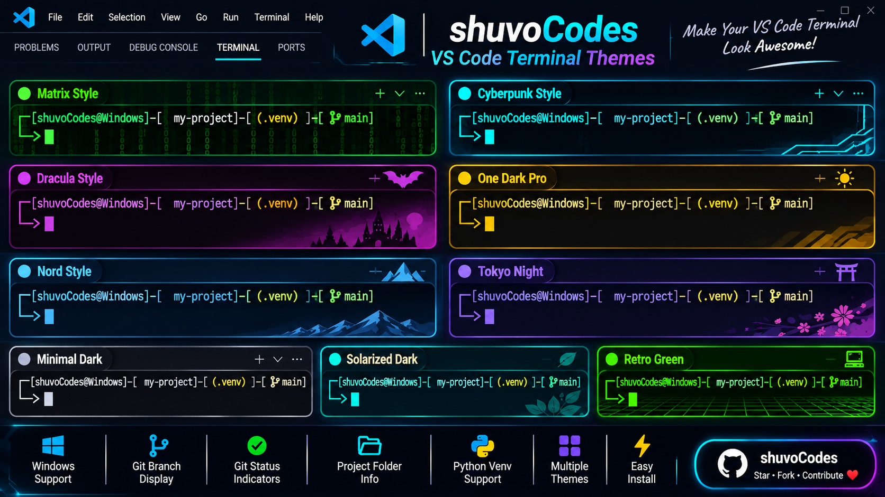

# 📖 User Manual — vscode-terminal-themes

Welcome to the **vscode-terminal-themes** user manual! This guide provides comprehensive instructions on installation, daily usage, theme customization, color breakdowns, and uninstallation.

Repository: [https://github.com/shuvoCodes/vscode-terminal-themes](https://github.com/shuvoCodes/vscode-terminal-themes)

---

## 🖼️ Visual Preview



---

## ⚡ 1. Installation

### 🟦 For PowerShell (Windows Terminal & VS Code)
Open **PowerShell** and paste:

```powershell
irm https://raw.githubusercontent.com/shuvoCodes/vscode-terminal-themes/main/install.ps1 | iex
```

---

### 🟥 For Git Bash (VS Code Integrated Terminal & Git Bash)
Open **Git Bash** and paste:

```bash
curl -fsSL https://raw.githubusercontent.com/shuvoCodes/vscode-terminal-themes/main/install.sh | bash
```

> **Synchronized Settings:** Installing from either terminal automatically sets up both **PowerShell** and **Git Bash**! Your chosen theme (`theme.txt`), arrow style (`arrow.txt`), and git branch indicator (`branch.txt`) stay 100% synchronized across both terminals.

---

### Method B — Manual Installation (Local Clone)
If you already cloned the repository locally:

```powershell
# In PowerShell:
.\install.ps1

# In Git Bash:
bash ./install.sh
```

---

## 🎨 2. Changing Themes

Use the `Set-TerminalTheme` cmdlet to switch themes on the fly. The change is saved automatically and persists across sessions.

```powershell
# 1. Matrix Style (Hacker green on black)
Set-TerminalTheme -Theme Matrix

# 2. Cyberpunk Style (Futuristic neon cyan)
Set-TerminalTheme -Theme Cyberpunk

# 3. Dracula Style (Gothic magenta & purple)
Set-TerminalTheme -Theme Dracula

# 4. One Dark Pro Style (Warm yellow & orange)
Set-TerminalTheme -Theme OneDarkPro

# 5. Nord Style (Arctic minimal blue & white)
Set-TerminalTheme -Theme Nord

# 6. Tokyo Night Style (Synthwave purple & pink)
Set-TerminalTheme -Theme TokyoNight

# 7. Minimal Dark Style (Clean monochrome white)
Set-TerminalTheme -Theme MinimalDark

# 8. Solarized Dark Style (Retro warm teal & green)
Set-TerminalTheme -Theme SolarizedDark

# 9. Retro Green Style (Old-school phosphor CRT green)
Set-TerminalTheme -Theme RetroGreen
```

### Change Arrow Symbol Style:
You can also choose how the prompt arrow connects to the line:

```powershell
# 1. Pointer (Default — 100% seamless connected arrow: └─► )
Set-TerminalTheme -ArrowStyle Pointer

# 2. Angle (Modern Starship/Oh My Posh chevron: └─❯ )
Set-TerminalTheme -ArrowStyle Angle

# 3. Triangle (Small centered triangle: └─▸ )
Set-TerminalTheme -ArrowStyle Triangle

# 4. Greater (Classic greater-than: └─> )
Set-TerminalTheme -ArrowStyle Greater

# 5. Arrow (Unicode right arrow: └─→ )
Set-TerminalTheme -ArrowStyle Arrow
```

### Change Git Branch Icon & Status Indicator:
You can choose the Git branch indicator style:

```powershell
# 1. Status (Default — ✔ when clean/uploaded, ✗ when changed/not uploaded):
Set-TerminalTheme -BranchIcon Status

# 2. Leaf (🌿 works out of the box on Windows without Nerd Fonts):
Set-TerminalTheme -BranchIcon Leaf

# 3. Symbol (Standard Unicode branch symbol: ⎇ ):
Set-TerminalTheme -BranchIcon Symbol

# 4. NerdFont (Classic Nerd Font git branch glyph:  — requires a Nerd Font):
Set-TerminalTheme -BranchIcon NerdFont

# 5. None (Display branch name with no icon):
Set-TerminalTheme -BranchIcon None
```

---

## 🔍 3. Inspecting & Previewing Themes

### View All Available Themes
Check which themes are installed and see which one is currently active:

```powershell
Get-TerminalThemes
```

### Preview a Theme Without Applying It
Preview any theme card (showing both clean and dirty Git states) without altering your current saved theme:

```powershell
# Preview a single theme:
Show-ThemePreview -Theme Cyberpunk

# Preview all 9 themes in sequence:
Show-ThemePreview
```

---

## 🌈 4. Theme Catalog & Color Breakdown

| Theme Name | Primary Palette | Key Hex Colors | Aesthetic & Vibe |
|---|---|---|---|
| **`Matrix`** | Green on Black | Frame `#00FF41` • User `#53FEA7` • Venv `#FFFF00` | Classic cyberpunk terminal / Matrix code rain |
| **`Cyberpunk`** | Cyan on Dark | Frame `#00F0FF` • Branch `#00FF66` • Dirty `#FF0055` | High-tech neon night city |
| **`Dracula`** | Magenta & Purple | Frame `#FF79C6` • User `#BD93F9` • Venv `#F1FA8C` | Popular gothic dark theme for developers |
| **`OneDarkPro`** | Yellow & Orange | Frame `#E5C07B` • Path `#ABB2BF` • Dirty `#E06C75` | Warm, comfortable Atom/VS Code palette |
| **`Nord`** | Blue & White | Frame `#88C0D0` • User `#81A1C1` • Path `#ECEFF4` | Arctic frost, minimal and clean |
| **`TokyoNight`** | Purple & Pink | Frame `#BB9AF7` • User `#7AA2F7` • Venv `#E0AF68` | Tokyo neon lights and synthwave aesthetic |
| **`MinimalDark`** | White on Black | Frame `#FFFFFF` • Path `#FFFFFF` • Venv `#FACC15` | Simple, distraction-free monochrome |
| **`SolarizedDark`** | Teal & Cyan | Frame `#2AA198` • Path `#93A1A1` • Branch `#859900` | Ergonomic retro warm color balance |
| **`RetroGreen`** | Phosphor Green | Frame `#00FF00` • Path `#66FF66` • Venv `#FFFF00` | 80s/90s CRT monochrome green phosphor monitor |

---

## 🧠 5. What the Prompt Segments Mean

Your terminal prompt uses a 2-line structure:

```
┌─[shuvoCodes@Windows]-[ my-project ]-[ (.venv) ]-[  main]
└─► █
```

### Line 1 (Context Bar):
- **`┌─`**: Top frame bracket.
- **`[shuvoCodes@Windows]`**: Active username and computer name.
- **`[ my-project ]`**: Current folder / working directory name.
- **`[ (.venv) ]`**: Active Python virtual environment (hidden when no venv is activated).
- **`[  main]`**: Current Git branch (hidden when not inside a Git repository).

### Line 2 (Action Line):
- **`└─► `**: Input pointer arrow (seamlessly aligned with the horizontal frame line).
  - 🟢 **Green Arrow**: Git working tree is **clean** (no uncommitted changes).
  - 🔴 **Red Arrow**: Git working tree is **dirty** (uncommitted edits or untracked files).
  - Outside Git repositories, the arrow uses the theme's primary accent color.

---

## 🛠️ 6. Resetting & Uninstallation

### Temporary Reset (Current Session)
To temporarily restore the standard default PowerShell prompt (`PS C:\> `):

```powershell
Reset-TerminalTheme
```

### Complete Uninstall
To completely remove **vscode-terminal-themes** from your PowerShell `$PROFILE`:

```powershell
Reset-TerminalTheme -Uninstall
```

Alternatively, manually edit your `$PROFILE`:
```powershell
notepad $PROFILE
```
Delete the lines between `# shuvoCodes START` and `# shuvoCodes END`, then save the file.

---

## ❓ 7. Troubleshooting & FAQ

1. **Scripts execution error (`cannot be loaded because running scripts is disabled`):**  
   Run PowerShell as Administrator and execute:
   ```powershell
   Set-ExecutionPolicy RemoteSigned -Scope CurrentUser
   ```

2. **Branch icon looks like a square or question mark:**  
   The default branch icon (``) uses Nerd Fonts. If your terminal font does not support Nerd Fonts, you can use standard emoji branch representation by setting:
   ```powershell
   $global:ShuvoCodesUseEmoji = $true
   ```
   Or install a Nerd Font such as **Cascadia Code NF**, **FiraCode Nerd Font**, or **JetBrains Mono NF** and select it in VS Code settings (`terminal.integrated.fontFamily`).

3. **Reload terminal after making changes:**  
   You can reload your profile anytime without restarting VS Code:
   ```powershell
   . $PROFILE
   ```
